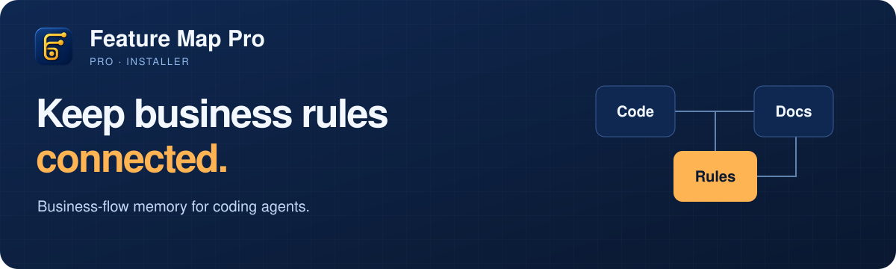

<div align="center">

<picture>
  <source media="(max-width: 600px)" srcset="assets/brand/readme-banner-mobile.svg" />
  
</picture>

# Feature Map Pro Installer

**Pasang Pro, aktifkan lisensi, lalu mulai sesi agent baru.**

[Instalasi](#instalasi) · [Platform](#platform) · [Pembaruan](#pembaruan) · [Bantuan](#bantuan)

</div>

Installer gratis untuk Feature Map Pro. Fitur premium memerlukan aktivasi; core
Free tetap gratis dan berlisensi MIT. Source premium tidak termasuk paket npm.

## Instalasi

```bash
npx @ade-syofyan/feature-map-pro@latest install
```

1. Masukkan email pembelian dan kode lisensi.
2. Tunggu aktivasi serta pemasangan skill selesai.
3. Buka sesi Codex baru untuk memuat instruksi terbaru.

Kode disamarkan saat diketik atau ditempel. Ctrl+U menghapus input dan Ctrl+C
membatalkan. Jangan memasukkan kode lisensi sebagai argumen command.

Jika menerima file lisensi:

```bash
npx @ade-syofyan/feature-map-pro@latest install --email buyer@example.com --license-file /path/to/buyer.license
```

Email dan path di atas hanya contoh. Periksa status:

```bash
npx @ade-syofyan/feature-map-pro@latest license status
```

## Yang didapat

| Kebutuhan | Bantuan Pro |
| --- | --- |
| Sebelum mulai tugas | Bekal Tugas membawa aturan dan konteks yang terkait. |
| Saat kebijakan berubah | Riwayat Aturan menyimpan keputusan dan revisinya. |
| Saat melanjutkan tugas | Lanjut Tugas menandai konteks dan bukti yang perlu direview ulang. |

Pemeriksaan tetap memerlukan review. Laporan bukan pengunci editor atau jaminan
semua konflik kebijakan terdeteksi.

## Platform

| Platform | Dukungan |
| --- | --- |
| macOS | Apple Silicon |
| Windows | x64, Windows 10/11 dengan tar bawaan |
| Linux | x64 glibc, Ubuntu 22.04+ |

Windows ARM, Linux ARM, Alpine/musl dan Mac Intel belum didukung.

**Prasyarat:** Node 18.20.8+, Git, tar dan Python 3 untuk core CLI/hook. Versi Node
installer tidak membatasi versi proyek yang dipetakan. Proyek Node 18 bisa dipetakan
pada Free maupun Pro; tes memerlukan runtime dan dependency proyek.

Installer memasang skill Codex. Untuk Claude Code, gunakan pengelola plugin dari
folder paket dan satu sumber Feature Map aktif. `--activate-only` mengaktifkan
lisensi tanpa memasang skill. [Core Free dan panduannya](https://github.com/ade-syofyan/feature-map)

## Pembaruan

Jalankan kembali command instalasi dengan `@latest`. Siapkan email dan lisensi
Anda. Instalasi skill sebelumnya disalin ke folder backup.

Jika memperbarui dari versi sebelum 0.23, hubungi penerbit terlebih dahulu untuk
mendapatkan kode yang sesuai. Jangan bagikan kode lisensi Anda.

## Bantuan

[Pembelian dan aktivasi](mailto:ade.syofyan@gmail.com) ·
[Laporkan masalah installer](https://github.com/ade-syofyan/feature-map-installer/issues) ·
[Rilis](https://github.com/ade-syofyan/feature-map-installer/releases)

Core, format registry dan integrasi agent mengikuti baseline Free. Perbaikan core
serta kompatibilitas tidak menjadi pembeda berbayar. Lihat [LICENSE](LICENSE) untuk
ketentuan installer.
